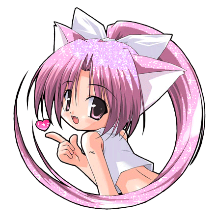
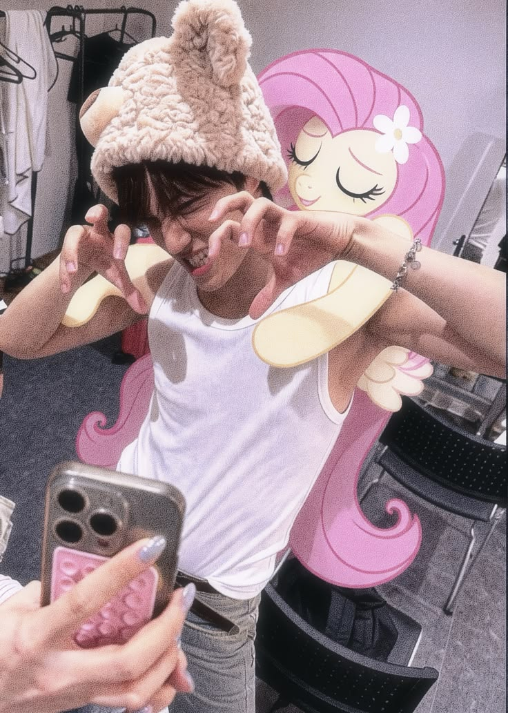
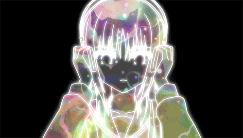
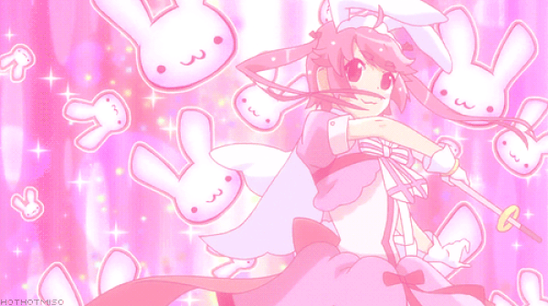
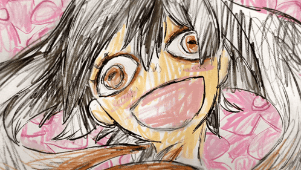

  

&nbsp;&nbsp;🎀 &nbsp;**gunner** on earth, **aegyoer** online 
&nbsp;&nbsp;💿 &nbsp;*internet angel / archive lover / part-time gremlin* 
&nbsp;&nbsp;🐧 &nbsp;distro: **"arch"** (it's ubuntu) 
&nbsp;&nbsp;🎧 &nbsp;jersey club 24/7, no skips 
&nbsp;&nbsp;🌙 &nbsp;`3am commits only` 
&nbsp;&nbsp;🌱 &nbsp;grass status: <kbd>untouched</kbd> 
&nbsp;&nbsp;📍 &nbsp;location: ✎ 
&nbsp;&nbsp;🛠️ &nbsp;building: ✎ 
&nbsp;&nbsp;💌 &nbsp;<kbd>do not perceive me</kbd> &nbsp;(◕‿◕)♡

 

 

 

<kbd>▶ now_playing.exe</kbd> &nbsp;✦&nbsp; <kbd>nya.gif</kbd> &nbsp;✦&nbsp; <kbd>usagi_mode.exe</kbd> &nbsp;✦&nbsp; <kbd>me debugging.mp4</kbd>

 

<!-- discord: join the Lanyard server (discord.gg/lanyard) then swap YOUR_DISCORD_ID for your user id -->

<!-- LETTERBOXD:START -->
🎞️ *films show up here after the "letterboxd diary" workflow runs* (◕‿◕)
<!-- LETTERBOXD:END -->

 

  

**leave a ⭐ to sign** &nbsp;·&nbsp; best viewed in netscape navigator 4.0 @ 800×600

<b>✦ click 4 secret ✦</b>

 
ﾟ･✿ dial-up in my soul ✿･ﾟ y2k forever ﾟ･✿ posting thru it ✿･ﾟ

