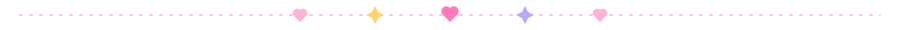

<div align="center">


    

</div>

<table>
<tr>
<td width="62%" valign="top">

### ⋆ hiii i'm aegyoer ⋆

```txt
name ....... aegyoer
from ....... ✎
vibe ....... pink, glittery, slightly chaotic
building ... ✎
learning ... ✎
ask me ..... ✎
```


</td>
<td width="38%" align="center" valign="middle">

</td>
</tr>
</table>



<table>
<tr>
<td align="center" valign="middle" width="45%">

<br/><sub>▶ now playing ♡</sub>
</td>
<td valign="top">

#### ✦ toolbox ✦


#### ✦ currently ✦

🎧 &nbsp;listening to ✎<br/>
🎀 &nbsp;obsessed with ✎<br/>
🍓 &nbsp;snack of the week ✎

</td>
</tr>
</table>


<p align="center">
  
  
</p>

<p align="center"><sub>★ ﾟ･✿ thx for stopping by ✿･ﾟ ★</sub></p>
